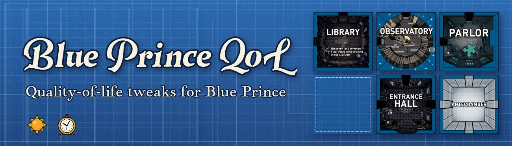
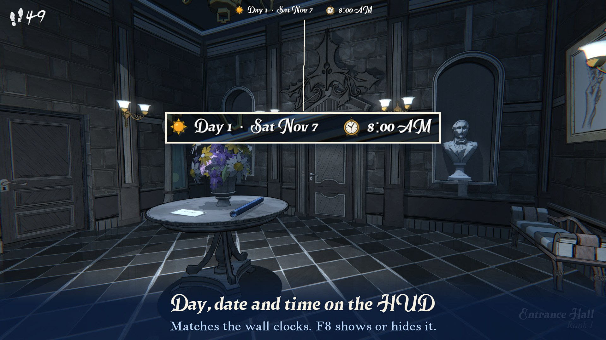
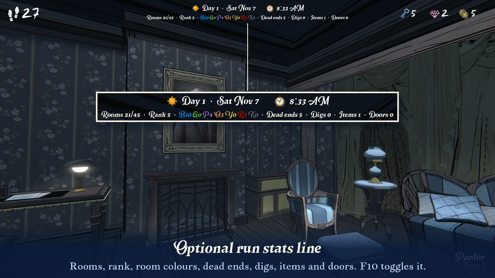
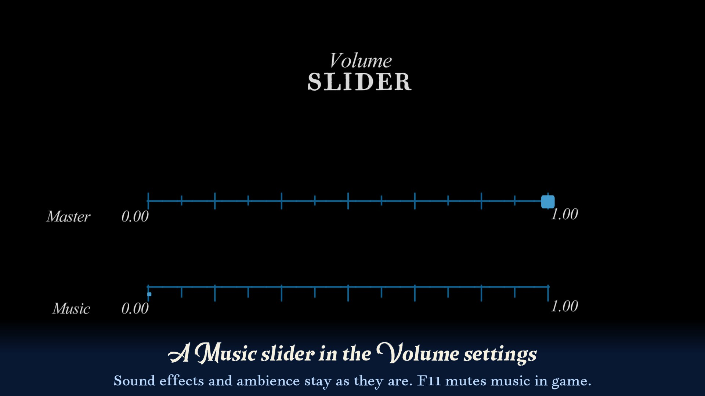
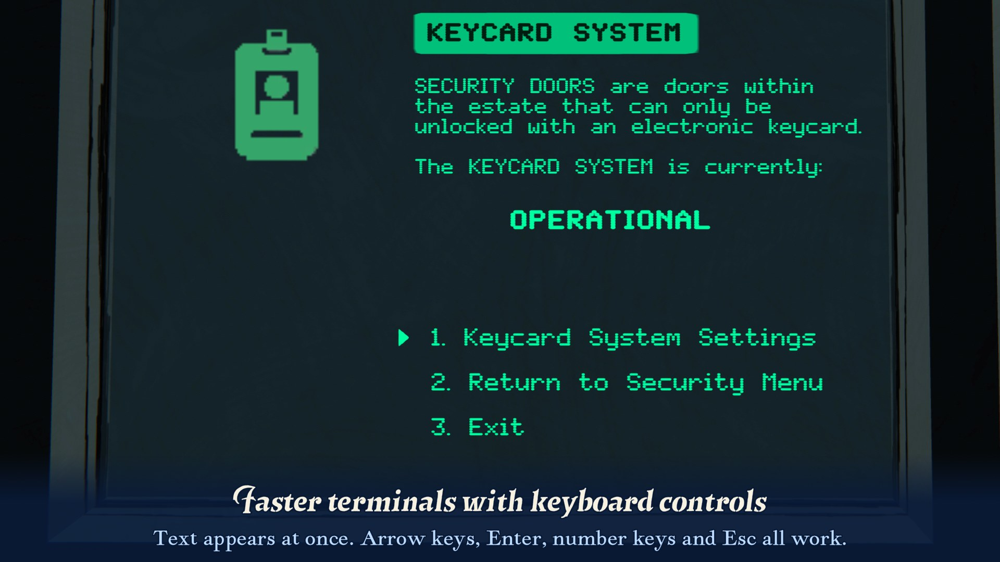

# Blue Prince QoL



Quality-of-life tweaks for **Blue Prince**, as a [MelonLoader](https://github.com/LavaGang/MelonLoader) mod.

Most of the mod removes waiting: shorter animations, fades and lock-outs that you sit through dozens of times a day. It doesn't change any game rules. Every feature can be switched off on its own.

> Unofficial fan mod. Not affiliated with or endorsed by Dogubomb or Raw Fury. Back up your save before installing any mod.

## Features

| Feature | What it does |
|---|---|
| HUD | Shows the in-game day, calendar date and time at the top of the screen, in the game's own font with sun and clock icons. It matches the wall clocks. F8 shows or hides it. |
| Run stats *(hidden by default)* | A second line with today's run: rooms drafted, rank, rooms by colour, dead ends, digs, items, unexplored doors, and a low-steps warning. F10 shows or hides it. |
| Boot skip | The logo slates at launch take a fraction of a second. |
| Intro skip | No camera glide at the start of each day; you have control at the gate straight away. |
| Pickup skip | Item pickup animations and the "You Found …" / "You Bought …" cards are skipped. Items are granted as normal. F9 is an emergency unfreeze in case you ever get stuck. |
| Terminals | Instant text and shorter pauses. Arrows/W/S and Enter navigate, keys 1 to 9 pick an option, and Esc/Backspace go back. |
| Camera zoom | The camera zooms onto terminals, the Dining Room plate and the Utility Closet fuse box 4× faster, in and out. |
| Door keys | The key animation on locked doors is 4× faster. The key is still spent exactly once. |
| Secret Garden | The crank sequence in the Secret Garden runs 4× faster: the gear, the camera fades, the arrow and the niche. The arrow and niche positions are saved as normal. |
| Elevators | Rides in the Boiler Room, Chamber of Mirrors, Foundation and cliff elevators are 3× faster. The whole game runs faster for the length of the ride, so everything stays in sync. Elevator sounds play at normal speed. |
| End of day | The end-of-day fades and diary reveal are 4× faster. The Save & Continue screens still wait for you. |
| Dare game over | In Dare mode, the Main Menu button on the Game Over screen shows up after 3 seconds instead of 10, and the fades around it are shorter. Press Space, Enter, Esc or click during the poem to skip ahead to the Game Over screen. |
| Digging | Shorter fade to black when digging. |
| Stairs warps | Shorter black screen for the game's *Stairs Skip* option (turn it on under Settings → Motion Assist). |
| Click unlock | Removes the ~1 s window after pickups, menus and doors where you can walk but can't click. |
| Cursor guard | Keeps the crosshair visible while an object animates and you can still move. In vanilla it disappears, for example while a Parlor box's key turns. |
| Move speed | Walking and running are 1.2× faster. Slowdowns, drafting and freezes still work, and step costs don't change. |
| Music volume | Adds a Music slider under the game's volume control (Settings → Volume). F11 mutes music. Sound effects and ambience aren't affected. |

## Screenshots









## Installation

1. Install MelonLoader 0.7.3 or later (IL2CPP, x64) into the game folder. The easiest way is the [MelonLoader installer](https://github.com/LavaGang/MelonLoader/releases) pointed at `BLUE PRINCE.exe`. Start the game once so MelonLoader can finish setting up, then close it.
2. Download `BluePrinceQoL.dll` from the [Releases](../../releases) page.
3. Put it in the game's `Mods` folder, e.g. `…/steamapps/common/Blue Prince/Mods/BluePrinceQoL.dll`.
4. Start the game. The MelonLoader log (`MelonLoader/Latest.log`) should list Blue Prince QoL.

### Linux / Steam Deck (Proton)

- Set the Steam launch options to `WINEDLLOVERRIDES="version=n,b" %command%` so Proton loads MelonLoader.
- Under Proton, MelonLoader's console window and start screen can freeze the game while it loads. In `UserData/Loader.cfg` (created after the first launch), set:
  ```toml
  hide_console = true
  disable_start_screen = true
  ```

## Configuration

Settings are in `UserData/MelonPreferences.cfg`, under `[BluePrinceQoL]`. The file is created on the first launch. Each feature has an `<Feature>_Enabled` switch, plus:

| Setting | Default | Meaning |
|---|---|---|
| `Hud_ToggleKey` | `F8` | Show or hide the HUD. Shift + this key logs diagnostics. |
| `Hud_Font` | `Room Text` | `Room Text` copies the font of the room name on the game's HUD. You can also use a game font name (e.g. `VersicaSerif SDF`), or `IMGUI` for plain text. |
| `Hud_PosX` / `Hud_PosY` / `Hud_Align` | `0.5` / `0.012` / `Center` | Position as a fraction of the screen, and alignment. |
| `Hud_FontScale` / `Hud_IconScale` | `0.03` / `1.15` | Text size (fraction of screen height); icon size relative to the text. |
| `Hud_Use24Hour` / `Hud_ShowDate` / `Hud_ShowIcons` | `false` / `true` / `true` | |
| `RunStats_ToggleKey` / `RunStats_Visible` | `F10` / `false` | |
| `RunStats_Show*` | various | Turn each stat on or off (rooms, rank, colours, dead ends, digs, items, doors, steps…). |
| `RunStats_LowStepsThreshold` | `10` | Show steps in red at or below this. |
| `BootSkip_MenuFadeIn` | `0.5` | Main menu fade-in time in seconds (vanilla: 4). |
| `PickupSkip_SkipFoundCards` / `_SkipShopCards` / `_SkipDigShopCards` | `true` / `true` / `false` | Which cards to skip (*DigShop* = "You Dug Up" cards). |
| `PickupSkip_UnfreezeKey` | `F9` | Emergency unfreeze. |
| `Terminal_InstantText` / `_FastWaits` / `_MaxPause` | `true` / `true` / `0.5` | |
| `Terminal_NumberKeys` / `_ShowNumbers` / `_BackKeys` / `_EscapeClosesTerminal` | `true` | Keyboard controls. |
| `CameraZoom_Speed` | `4` | Zoom speed multiplier (1 = vanilla, 0 = instant). |
| `CameraZoom_Terminals` / `_DiningRoom` / `_UtilityPanel` / `_EatFade` | `true` | What to speed up. |
| `CameraZoom_OtherObjects` | `false` | Also speed up the same zoom on safes, dartboards, the Room 46 map, shrines and similar objects. |
| `DoorKeySpeed_Speed` | `4` | Key animation speed (1 = vanilla). |
| `DoorKeySpeed_Hotkeys` / `_UseKey` / `_ExitKey` | `false` / `Return` / `Backspace` | Keyboard USE/EXIT on the lock prompt. |
| `SecretGarden_Speed` | `4` | Crank sequence speed (1 = vanilla, at most 10). |
| `ElevatorSpeed_Speed` | `3` | Elevator ride speed (1 = vanilla, at most 6). |
| `ElevatorSpeed_BoilerRoom` / `_ChamberofMirrors` / `_Foundation` / `_Cliff` | `true` | Which elevators to speed up. |
| `EndOfDay_Speed` / `_StatsAllAtOnce` / `_MorningFade` | `4` / `false` / `true` | |
| `DareGameOver_MenuDelay` | `3` | Seconds on the Game Over screen before the Main Menu button appears (vanilla: 10). |
| `DareGameOver_SkipKeys` | `Space,Return,Escape,Mouse0` | Keys that skip the poem. Comma-separated Unity key names; `Mouse0` is left click. Leave empty to turn skipping off. |
| `DareGameOver_AutoSkip` | `false` | Always skip the poem, without a key press. |
| `DigSpeed_Speed` / `_XMarksTheSpot` | `4` / `false` | |
| `StairsWarp_Speed` / `_FadeIn` | `4` / `true` | |
| `ClickUnlock_Delay` | `0.1` | Seconds before you can click again after being unfrozen. |
| `MoveSpeed_WalkMultiplier` / `_RunMultiplier` | `1.2` / `1.2` | Allowed range: 0.5 to 3. |
| `MusicVolume_Volume` / `_Muted` / `_MuteKey` | `1.0` / `false` / `F11` | Also adjustable from Settings → Volume. |
| `MusicVolume_IncludeCutscenes` | `false` | By default, cutscene videos keep their sound while music is turned down. |

`StateLogger_Enabled` (off) is a debugging aid. It writes every game state change to the MelonLoader log.

## Compatibility

- Built against MelonLoader 0.7.3 and the Steam version of Blue Prince (Unity 6000.0.58).
- [UnityExplorer](https://github.com/yukieiji/UnityExplorer) works alongside it.
- Game updates can rename things the mod relies on. If that happens, the affected feature logs a warning and the game behaves as normal for that part.

## Building from source

Requirements: .NET SDK 6.0 or later, Python 3 with Pillow (`pip install pillow`), and the game with MelonLoader installed and launched once. The build references MelonLoader's generated assemblies in the game folder.

```bash
cd src/BluePrinceQoL
dotnet build -c Release
```

This builds `BluePrinceQoL.dll` and copies it into the game's `Mods` folder. If your game isn't in the default Steam library, pass `-p:GameDir="/path/to/Blue Prince"`. Pass `-p:CopyToGame=false` to build without copying. The HUD icons in `assets/` are converted and embedded at build time by `tools/png2rgba.py`.

## License

Copyright © 2026 Lucas Pospor.

This program is free software: you can redistribute it and/or modify it under the terms of the GNU General Public License as published by the Free Software Foundation, version 3. See [LICENSE](LICENSE).
